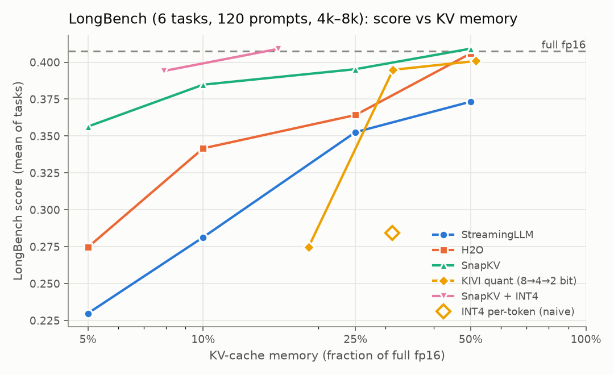
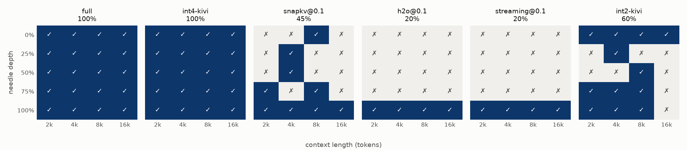
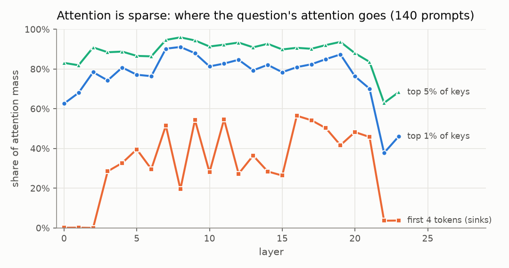
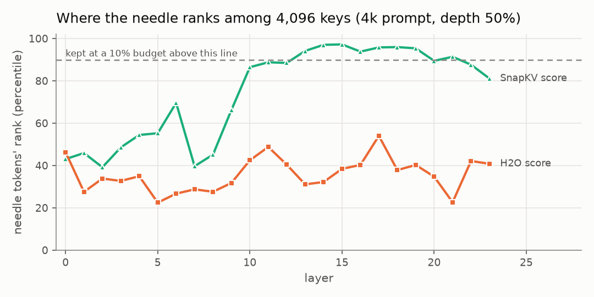
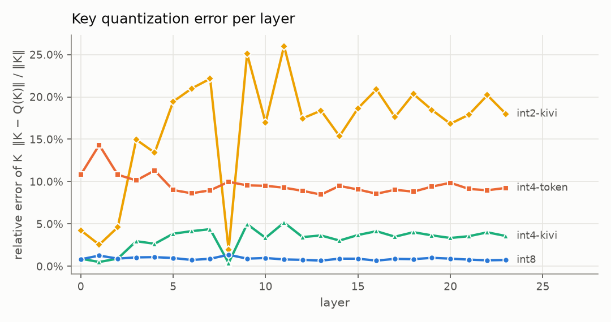

# kv-compress

How much of an LLM's KV cache can you throw away (or squeeze into fewer bits) before it stops
answering correctly on long documents?

This repo implements four families of KV-cache compression from scratch and measures their
**accuracy vs memory trade-off** on long-context tasks, using **Qwen2.5-0.5B-Instruct** on a
4 GB laptop GPU:

| strategy | idea | paper |
|---|---|---|
| **StreamingLLM** | keep 4 "attention-sink" tokens + a recent window | Xiao et al., 2023 |
| **H2O** | keep the keys with the most accumulated attention (+ recent) | Zhang et al., 2023 |
| **SnapKV** | keep the keys *the question* attends to, max-pooled (+ the question) | Li et al., 2024 |
| **INT8 / INT4 / INT2** | keep every token in fewer bits. Per-token vs **KIVI** (keys per channel, values per token) | Liu et al., 2024 |
| **SnapKV + INT4** | evict *and* quantize | (combination) |

All of it is evaluated on **needle-in-a-haystack** (2k–16k tokens, 5 needle depths) and **6
LongBench tasks** (120 prompts of 5k–8k tokens). The model forward pass, attention statistics,
eviction policies and bit-packed quantizers are all hand-written.



## Headline results

| variant | KV memory | needle acc. | LongBench | K error |
|---|---:|---:|---:|---:|
| full fp16 | 100% | 100% | 40.8 | - |
| **INT8** (per token) | 51.6% | 100% | 40.1 | 0.9% |
| **INT4-KIVI** | 31.4% | **100%** | 39.5 | 3.2% |
| INT4 per-token (naive) | 31.2% | 10% | 28.4 | 9.6% |
| INT2-KIVI | 18.9% | 60% | 27.5 | 16.4% |
| **SnapKV + INT4-KIVI**, keep 25% | **7.9%** | 70% | **39.4** | 3.5% |
| SnapKV, keep 25% | 25% | 75% | 39.5 | - |
| SnapKV, keep 10% | 10% | 45% | 38.5 | - |
| H2O, keep 25% | 25% | 20% | 36.4 | - |
| StreamingLLM, keep 25% | 25% | 20% | 35.3 | - |

Every budget, per-task scores and per-length needle accuracy are in
[`results/summary.md`](results/summary.md).

What the numbers say:

1. **Quantization is the safe first step, but only with the right grouping.** INT4 with KIVI's
   grouping (keys per *channel*) loses about 1 LongBench point and no needles at 31% memory.
   The *same 4 bits* grouped per token collapse to 10% needle accuracy. The only difference is
   how the scale and zero-point are shared ([why](#3-quantization-error-keys-have-outlier-channels)).
2. **Question-aware eviction beats question-agnostic eviction.** At a 25% budget SnapKV keeps
   75% of needles. H2O and StreamingLLM keep only the needle placed right before the question,
   which sits inside their recent window.
3. **The two ideas stack.** SnapKV at 25% plus INT4-KIVI stores **12.7× less KV** than fp16 and
   stays within 1.4 LongBench points of the full cache.
4. **Retrieval breaks before "understanding" does.** H2O at 10% keeps 84% of the full LongBench
   score, yet finds none of the needles outside its recent window. Aggregate QA scores hide the
   failures that compression actually causes.



---

## The concepts

### 1. Why compress the KV cache at all (long context)

During generation every layer keeps a key and a value vector for every past token. For this
model that's `2 × 24 layers × 2 KV heads × 64 dims × 2 bytes = 12 KiB per token`. A 16k-token
document is therefore about **190 MB per sequence**, a 128k context about 1.5 GB, and a 7B model
is ~10× worse. The cache grows linearly with context and with batch size, and on a server it is
what limits how many users fit on a GPU.

There are two ways to shrink it:

- **Keep fewer tokens** (eviction). This relies on attention being sparse.
- **Keep every token in fewer bits** (quantization). This relies on K and V tolerating rounding
  error.

### 2. Attention sparsity

When the model reads a question at the end of a long prompt, where does its attention go?
Measured over all 140 prompts:



- **The top 1% of keys get 77% of the attention mass, and the top 5% get 88%.** Most of the
  cache is barely read, which is why eviction can work at all.
- **The first 4 tokens get about 32%** (more than 50% in some middle layers), even though they
  are just `<|im_start|>system...`. These are **attention sinks**: softmax has to put its
  probability mass *somewhere*, and models learn to dump it on the first tokens. Evicting them
  is catastrophic, which is the StreamingLLM paper's key observation.
- The last layers (22–23) are much less sparse. A uniform per-layer budget is a simplification;
  methods like PyramidKV give different layers different budgets.

**But "which keys matter" depends on who is asking.** H2O scores keys by attention accumulated
over *every* prompt token, so it keeps what the *document* found important. The needle is an
unremarkable sentence in the middle of a government report, and nothing in the report attends to
it. SnapKV scores keys by what the *question* attends to:



In a 4k-token prompt, H2O ranks the needle's 7 digit tokens at the **36th percentile**, below an
average key, so a 10% budget keeps them in 1 of 24 layers. SnapKV ranks them at the 75th
percentile, and above the 90th percentile in the middle layers (where retrieval happens), keeping
them in 13 of 24 layers. (`python explain_needle.py`)

The catch: SnapKV only knows the question because it is in the prompt when the cache gets
compressed. If you compress a document *before* the question arrives (cached context, multi-turn
chat), SnapKV falls back to being question-agnostic too.

### 3. Quantization error: keys have outlier channels

Quantization maps each group of numbers to `2^bits` levels between the group's min and max,
storing one fp16 scale and zero-point per group:

```
q = round((x - min) / scale),   scale = (max - min) / (2^bits - 1),   x̂ = q · scale + min
```

The error depends on how *spread out* a group is. **Keys have outlier channels.** Measured on a
4k prompt, the largest key channel is on average 4.9× the median channel, and up to 20× in some
layers. Values are flat by comparison: 2.1× on average, 3.6× at most
(`python scripts/key_outliers.py`). If a group runs *across* channels (per-token), one outlier
channel stretches the range, and the normal channels in that group get only a few of the 16
levels. KIVI instead groups keys **per channel**
(the same channel across 32 consecutive tokens), so each outlier channel gets its own scale.
Values have no such outliers, so they are quantized per token.



Same bits, same memory, 3× lower key error (3.2% vs 9.6%). In accuracy that's 100% vs 10% of
needles. INT2 cuts memory to 19% but more than doubles the error again (16%). Long, exact
retrievals such as a 7-digit number fail first, because one wrong digit fails the needle.

Memory includes the overhead. An fp16 scale and zero per 32 values costs 1 bit per value, so
"INT4" is really 5 bits per value (31.4% of fp16), and INT8 with one scale per token-head is 51.6%.

### 4. Eviction policies in one picture

For a budget of *b* tokens out of *S*, per layer and per KV head:

```
StreamingLLM  [sink x4][..............evicted...............][ recent b-4 ]
H2O           [..hh..][....hh.....][......hh......hh......][ recent b/2 ]   hh = top accumulated attention
SnapKV        [..hit..][....hit.hit.....][....hit....hit...][ question w=32 ]  hit = top question attention,
                                                                             max-pooled (neighbours of a hit survive)
```

Tokens keep their original positions; RoPE is already baked into the cached keys. Only full
attention over the prompt (prefill) is exact. Every generated token, *including re-reading the
last prompt token*, attends only to the compressed cache, so no answer token comes for free from
the uncompressed prefill.

---

## Setup and protocol

```bash
git clone https://github.com/sathvik8317/kv-compress.git && cd kv-compress
python -m venv .venv && .venv\Scripts\activate          # Linux/macOS: source .venv/bin/activate
pip install torch --index-url https://download.pytorch.org/whl/cu128
pip install -e ".[dev]"
bash scripts/download_longbench.sh                       # ~114 MB into data/

pytest                       # 10 tests (2 need a GPU)
python evaluate.py           # ~30 min on an RTX 3050 4 GB -> results/raw.jsonl (resumable)
python analyze.py            # -> results/summary.md + results/figures/
python explain_needle.py     # needle rank analysis
```

**Protocol** (the "compress after prefill" setting used by the SnapKV paper and NVIDIA kvpress):

1. One full-precision prefill of the whole prompt (document + question). It records each layer's
   K/V plus the two statistics the eviction policies need: H2O's attention accumulated over all
   prompt queries, and SnapKV's attention from the last 32 queries.
2. All 19 variants are built from that one prefill. Each variant gets a compressed cache of
   prompt tokens `[0, S-1)`, re-reads the last prompt token through it, and decodes greedily.
3. The variants are decoded **as one batch** (in memory-capped groups). At batch size 1 decoding
   is launch-bound, so 19 variants cost about the same as one.

**Tasks**

- **Needle in a haystack.** "The special magic number for Oslo is: 4831057." is inserted into
  real prose (LongBench gov_report documents, *not* repeated filler, which makes every method
  look perfect). 4 lengths × 5 depths, scored 1 if the number appears in the answer.
- **LongBench-E**, 4k–8k-word bucket, 20 prompts each from multifieldqa_en, hotpotqa, 2wikimqa
  (QA F1), triviaqa (F1, few-shot), trec (classification accuracy, few-shot) and lcc (code
  edit similarity). LongBench's own prompts, generation lengths and middle truncation (to 8k
  tokens) are used.

**Correctness checks** (`tests/`)

- The full-cache path matches HF `generate()` token for token.
- Re-reading the last prompt token through the cache reproduces the prefill's own argmax.
- Every eviction policy at a keep ratio of 1.0 reproduces the full output exactly.
- The H2O and SnapKV statistics sum exactly to `queries × heads` (softmax rows sum to 1).
- Bit packing round-trips losslessly, and KIVI beats per-token grouping on keys with outlier
  channels.

## Caveats

- **Small samples.** 20 needles and 20 prompts per LongBench task. Per-task differences under
  about 3–5 points are noise: INT8, at 0.9% key error, still moves lcc by −8 and hotpotqa by +4,
  because one changed token sends greedy decoding down a different path. The large gaps (INT4
  per-token vs KIVI, SnapKV vs H2O on needles) are far outside that.
- **One small model.** Qwen2.5-0.5B is fragile at 16k (even SnapKV at 50% drops a digit) and
  weak on multi-hop QA (2wikimqa ≈ 9 F1 with the full cache). Larger models usually tolerate
  compression better.
- **H2O is applied once after prefill**, using attention accumulated over the prompt, like most
  long-context benchmarks of it. The original also keeps evicting greedily during decoding.
- **Quantization is "store quantized, dequantize to compute".** Storage is real (bit-packed, and
  memory is measured from the tensors), but decode dequantizes once instead of using a fused
  low-bit attention kernel, so this measures accuracy and memory, not speed. The ≤64 generated
  tokens stay fp16, like KIVI's full-precision residual.
- A uniform budget per layer and head; no per-layer allocation (PyramidKV) or per-head allocation
  (AdaKV).

## Engineering notes

- **The cache allocator can blow past VRAM on Windows.** Chunked prefill with variable-size
  chunks fragmented PyTorch's caching allocator until it *reserved 10.6 GB on a 4 GB GPU*. The
  Windows driver silently backs the overflow with system RAM, and prefill slowed from 18 s to
  113 s at 16k tokens. A smaller fixed score budget (64 MB) fixed it.
- **GQA folded into the matmul.** The 7 query heads sharing a KV head are stacked as 7× more
  rows of one `[g·Q, d] @ [d, S]` product, instead of `repeat_interleave`-ing K and V 7×.
- **O(S²) attention statistics without O(S²) memory.** Attention is computed in query chunks,
  and each chunk's probabilities are summed into the per-key statistics before being freed.

## Code map

```
kvcompress/
  model.py     hand-written Qwen2: chunked prefill that also records H2O / SnapKV attention
               statistics; batched multi-variant greedy decode over compressed caches
  methods.py   eviction (streaming, h2o, snapkv) and quantization (QTensor: int8, int4/int2,
               per-token or KIVI per-channel, real bit-packing, exact byte counts)
  runner.py    builds all variants for one prompt and decodes them in memory-capped groups
  tasks.py     needle-in-a-haystack builder, LongBench prompts and metrics
evaluate.py    runs everything -> results/raw.jsonl
analyze.py     tables + figures
explain_needle.py   needle-rank analysis (H2O vs SnapKV scores)
tests/         unit tests (selection, quantization) + model tests vs HF generate()
results/       summary.md, raw.jsonl, needle_ranks.json, figures/
```

Related: [mini-vllm](https://github.com/sathvik8317/mini-vllm), my paged-KV inference engine.
These policies are the next step for it.

## References

- Xiao et al., *Efficient Streaming Language Models with Attention Sinks*, 2023 ([arXiv:2309.17453](https://arxiv.org/abs/2309.17453))
- Zhang et al., *H2O: Heavy-Hitter Oracle for Efficient Generative Inference of LLMs*, 2023 ([arXiv:2306.14048](https://arxiv.org/abs/2306.14048))
- Li et al., *SnapKV: LLM Knows What You are Looking for Before Generation*, 2024 ([arXiv:2404.14469](https://arxiv.org/abs/2404.14469))
- Liu et al., *KIVI: A Tuning-Free Asymmetric 2bit Quantization for KV Cache*, 2024 ([arXiv:2402.02750](https://arxiv.org/abs/2402.02750))
- Bai et al., *LongBench*, 2023 ([arXiv:2308.14508](https://arxiv.org/abs/2308.14508))
- [NVIDIA kvpress](https://github.com/NVIDIA/kvpress), a library of KV-cache compression methods

## License

MIT, see [LICENSE](LICENSE).
